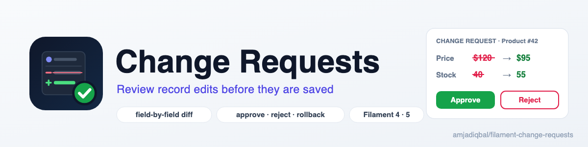

  <picture>
    <source media="(prefers-color-scheme: dark)" srcset="art/banner-dark.png">
    
  </picture>

# Change Requests for Filament

Hold edits to your Filament records as change requests. An approver sees the old and new value of
each field, then approves, rejects or rolls back the change. Built on
[cjmellor/approval](https://github.com/cjmellor/approval), for Filament 4 and 5.

> **Status: in development.** Nothing is released yet. The first release will be announced here and on Packagist.

## Support

- 🐛 **Bug or feature request**: [open an issue](https://github.com/amjadiqbal/filament-change-requests/issues)
- 🔒 **Security issue**: please report it privately through GitHub's security tab

## Need this customised, or something built?

I'm available for custom development, package integration, and technical consulting.

## More packages

This is part of a family of open-source packages. See [all of them](https://github.com/amjadiqbal?tab=repositories).

| | |
|---|---|
| [filament-url-image-uploader](https://github.com/amjadiqbal/filament-url-image-uploader) | Upload images to Filament from a URL |
| [refresher](https://github.com/amjadiqbal/refresher) | Restore a cached test database instead of migrate:fresh |
| [kiln](https://github.com/amjadiqbal/kiln) | Deploy-time OPcache control for Laravel |

## Credits

- [Amjad Iqbal](https://github.com/amjadiqbal)
- Approval engine: [cjmellor/approval](https://github.com/cjmellor/approval) by Chris Mellor (MIT)

## License

The MIT License (MIT). See [LICENSE.md](LICENSE.md).
